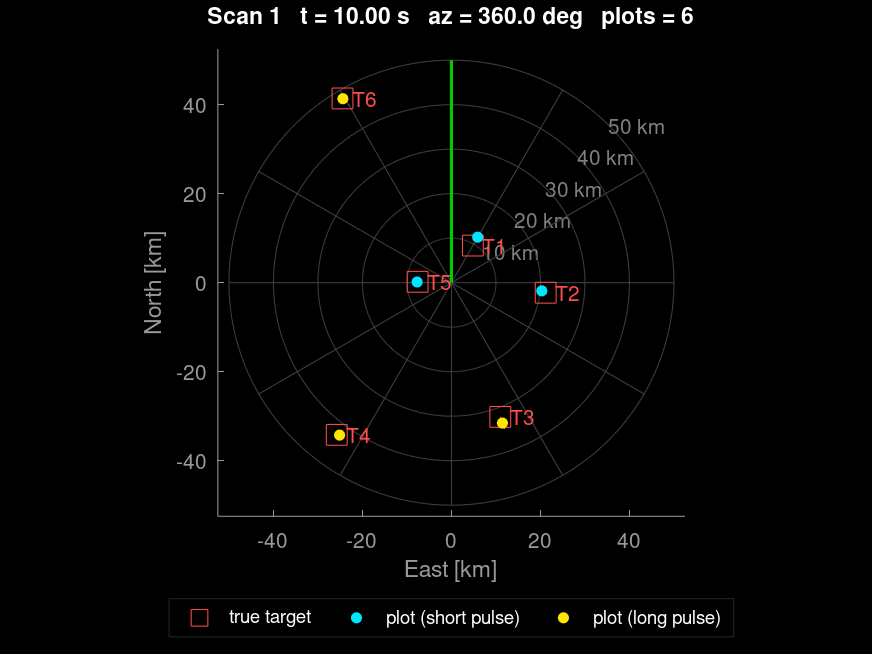

# Rotating search radar simulator (MATLAB)

A simple, modular MATLAB simulation of a 3 GHz rotating search radar with a
48-element receive column, digital beamforming (DBF) in elevation and a
long + short sub-pulse in every PRI. Everything from the 120 MHz ADC
samples down to the PPI display is simulated. Each processing block is a
short function in `src/`. All parameters are in one file, `radar_config.m`.

The code runs in MATLAB with no toolboxes. It was tested with GNU Octave 8.4.

```
 targets + clutter + noise (IF, 48 elements, 120 MHz, int16, ENOB 12.7)
        |                                  \--> raw data: output/raw_pulses/pulse_<n>.mat  (+ optional UDP)
        v
 DDC  (mix, LPF h1, /10, LPF h2, /6, valid convolutions)    -> per sub-pulse [nSamples x 48]
 DBF  (21 x 48 matrix)                                       -> [21 beams x nSamples]
 Matched filter (valid convolution, Taylor window for LFM)  -> [21 beams x nRange]  (range/delay axes)
 CPI buffer (circular, pulses inside the 3 dB beamwidth)    -> [21 x nRange x nCPI], short and long
 MTI   fixed PRF: 3-pulse canceller | staggered: weights from file
 Doppler fixed: blocks of 32 + Hamming + FFT32 | staggered: de-interleave, Hamming, FFT32, NCI
 2-D CA-CFAR on every range-Doppler map
 Pruning (local peaks + sidelobe blanking) -> plot extraction (azimuth peak picking)
 PPI display (updated while the antenna turns)
```

## Quick start

```matlab
results = run_radar_sim;            % default configuration (full 360 deg scan)

cfg = radar_config;                 % or change parameters first
cfg.prf.mode = 'staggered';
cfg.clutter.enable = false;
cfg.sim.sectors_deg = [20 45];      % only simulate this azimuth sector
results = run_radar_sim(cfg);

addpath tests
run_all_tests                       % SNR budget + UDP + six-target tests
```

`make_input_files.m` creates the default input files in `inputs/`. It runs
automatically when a file is missing. Replace the files with your own data
(same variable names) to simulate another antenna, filter set or stagger.

## Files

| File | Purpose |
|---|---|
| `radar_config.m` | all user parameters |
| `run_radar_sim.m` | main loop: generation, recording, processing, display |
| `make_input_files.m` | default input .mat files |
| `src/setup_radar.m` | derives timing, axes, matched filters, CPI length, CFAR factor ... |
| `src/generate_rx_signal.m`, `clutter_init.m`, `clutter_signal.m`, `adc_sample.m` | signal generation |
| `src/save_pulse_file.m`, `udp_sender_open.m`, `udp_send_pulse.m`, `udp_receive_pulse.m` | raw data output |
| `src/ddc.m`, `fir_decimate_valid.m` | two-stage DDC |
| `src/digital_beamforming.m` | DBF |
| `src/matched_filter.m`, `plot_range_profile.m` | pulse compression, range/delay/index plots |
| `src/cpi_buffer_*.m` | circular CPI buffers |
| `src/mti_filter.m`, `doppler_process.m` | clutter filter, Doppler processing |
| `src/cfar_2d.m`, `cfar_alpha.m` | 2-D CA-CFAR |
| `src/prune_peaks.m`, `detection_reports.m`, `plot_extractor*.m` | pruning and plot extraction |
| `src/ppi_init.m`, `ppi_update.m` | PPI display |
| `src/snr_budget.m`, `print_snr_budget.m` | expected SNR after every block |
| `src/six_targets_scenario.m`, `make_target.m`, `target_geometry.m` | targets |
| `tests/` | tests (see below) |

## Input files (`inputs/`)

| File | Variables |
|---|---|
| `antenna_pattern.mat` | `nElements` (48), `elementSpacing_m`, `az_deg`, `azGain_dB` (one-way, 4.1 deg), `elRel_deg`, `elElemGain_dB` (element pattern vs. angle from broadside, 70 deg), `txElGain_dB`, `rxChannelGain_dBi`, `txGain_dBi` |
| `ddc_filters.mat` | `h1` (stage 1, 120 MHz), `h2` (stage 2, 12 MHz); unit DC gain |
| `dbf_matrix.mat` | `W` [21 x 48] (beam = W * x), `beamEl_deg` |
| `stagger_prf.mat` | `priVector_s` [K x 1], `mtiCoeffs` [K x L] (row k = weights of an MTI output whose first pulse has stagger position k; one row = fixed weights) |

## Model summary

* **Geometry:** antenna 6 m above flat ground, tilted 11 deg up, turning
  clockwise at 6 rpm. Targets fly with a constant velocity (`make_target.m`).
  Azimuth is measured clockwise from North.
* **PRI timeline:** long pulse (150 us) at t = 0, short pulse (25 us) right
  after it, then the receive window. Both sub-pulses use LFM (1 MHz) or a
  P4 phase code (1 us chips). Their IFs differ (22 / 38 MHz, RF = fc -/+ 8 MHz),
  so each DDC channel keeps only its own sub-pulse. The short pulse covers
  4.2 - 30 km, which fills the blind zone of the long pulse. The long pulse
  covers 26.7 km to `cfg.rx.maxRange_m`.
* **Received signal:** radar equation with the azimuth pattern, the
  transmit and element elevation patterns and the element phases of the
  tilted column. The model includes the Doppler inside each pulse
  (stop-and-hop between pulses), thermal noise (NF 4 dB), ADC noise
  (ENOB 12.7), rounding and clipping to int16. Signals are kept in ADC units (LSB).
  The receiver gain puts thermal noise 10 dB above the ADC noise floor.
* **Clutter:** constant sigma0 (-30 dB) Rayleigh cells (0.25 deg x 15 m) from
  1 km to the radar horizon, with internal motion (0.1 m/s). Scan modulation
  comes from the two-way azimuth pattern. The echo is convolved with the
  transmitted IF pulses, so partly received (eclipsed) echoes are included.
* **Axes:** the delay and range of every matched-filter output cell are
  computed in `setup_radar.m`. They account for the receive window start and
  the valid convolutions of the DDC and matched filters (`wv.delay_s`,
  `wv.range_m`). `plot_range_profile(rp, wv, 'range'|'delay'|'index')`
  plots against any of the three. Set
  `cfg.display.rangeProfilePulse = <pulse number>` to plot it during a run.
* **CPI:** `floor(dwell / PRI)` pulses fit in the 3 dB beamwidth (114 at
  1 kHz). With a fixed PRF the buffer holds 3 x 32 + 2 = 98 pulses: the
  3-pulse canceller output is split into blocks of 32, each block gets a
  Hamming window and an FFT, and the powers are averaged. With a staggered
  PRF (4 PRIs) the buffer holds 4 x 28 + 2 = 114 pulses: the MTI output is
  de-interleaved into 4 rows of 28 samples. Each row is sampled every
  sum(PRI); it gets a Hamming window and a 32-point FFT, and |X|^2 is
  averaged over the rows. The buffers slide by one pulse, and the
  Doppler/CFAR step runs on every new pulse (`cfg.proc.updateEvery`).
* **CFAR:** 2-D CA-CFAR, 8 + 3 (guard) range cells and 2 + 2 Doppler cells on
  each side, Pfa = 1e-7. The MTI colours the noise: [1 -2 1] gives +4 dB
  near PRF/2. So every Doppler bin is divided by its noise gain first, and
  the CFAR sees a flat noise floor. The threshold factor uses the effective
  number of independent rows. That is 3 with a fixed PRF, but only 1.5 with
  the default stagger, because de-interleaved rows are built from
  overlapping MTI outputs and their noise is correlated. Doppler bins within
  +-1 of zero (the MTI notch, where the clutter residue is) are not tested.
* **Pruning and plots:** only local maxima in beam x range x Doppler are
  kept. Range, elevation and Doppler sidelobes more than 20 dB below a
  stronger peak are removed. Detections of the same target in successive
  (sliding) CPIs are grouped, and the strongest one becomes a plot. A plot
  needs detections over at least 1 deg of antenna rotation
  (`cfg.extract.minExtent_deg`). Noise false alarms last only a few CPIs,
  while a target is detected over about one beamwidth. Elevation is
  interpolated between adjacent beams. The plot SNR is measured against the
  noise floor of the beam. The radial velocity is ambiguous (+-25 m/s with a
  fixed PRF, +-6.4 m/s with the default stagger).

## Raw data and UDP format

Every simulated PRI is saved as `output/raw_pulses/pulse_<number>.mat`.
`adcData` is int16 [nSamples x 48]. `hdr` holds the pulse number, scan
number, time, antenna azimuth, PRI, stagger index, fs, receive window start,
carrier and IFs, and sub-pulse timing. At 100 km instrumented range one PRI
is about 7.5 MB, so a full scan (10 000 PRIs) is about 75 GB. Use
`cfg.sim.sectors_deg` or a smaller `cfg.rx.maxRange_m` for long runs.

With `cfg.udp.enable = true`, every PRI is also sent to `cfg.udp.host:port`.
Each datagram has a 40-byte little-endian header followed by int16 samples
(channel after channel):

| Bytes | Type | Field |
|---|---|---|
| 0-3 | uint32 | magic 0x52414452 ('RADR') |
| 4-7 | uint32 | pulse number |
| 8-11 | uint32 | scan number |
| 12-15 | single | antenna azimuth [deg] |
| 16-17, 18-19 | uint16 | packet index (0-based), packet count |
| 20-21, 22-23 | uint16 | channels, stagger index |
| 24-27, 28-31 | uint32 | samples per channel, offset of the first sample in this packet |
| 32-39 | double | PRI start time [s] |

`src/udp_receive_pulse.m` is a reference receiver that reassembles one PRI.

## SNR budget

`print_snr_budget` (called at the start of every run) prints the expected
SNR of every target after the ADC, DDC, DBF, matched filter, MTI and Doppler
blocks. It also prints the SNR needed for Pd = 0.9 (Albersheim) and the
margin. Where a closed form would be approximate, the budget runs the real
processing functions on a noise-free target:
* the matched-filter loss: the pulse, with its Doppler shift, goes through
  the DDC filters and the matched filter. This covers the Taylor window,
  the DDC filtering of phase-code chips, and the Doppler mismatch, which is
  about -3.3 dB for a 150 us P4 code at 180 m/s.
* the slow-time gain: the MTI and Doppler functions run on the target and
  on white noise. This covers the MTI response, the Hamming loss, Doppler
  straddle and the azimuth beam shape over the CPI.

`tests/test_snr_budget.m` measures the SNR after every block of the
simulated chain (signal-only and noise-only runs) and compares it with the
budget. All blocks agree within 0.6 dB for LFM and P4, both pulses and both
PRF modes:

```
SNR budget check: fixed PRF, long pulse (lfm), R = 41.1 km, el = 6.0 deg, vr = -180 m/s, beam 3
Block      Expected   Measured     Diff
adc          -36.71     -36.76    -0.05
ddc          -21.50     -21.59    -0.09
dbf           -6.60      -6.71    -0.11
mf            16.81      16.46    -0.35
mti           20.32      20.25    -0.06
doppler       29.25      29.22    -0.03
```

## Tests

| Test | What it checks |
|---|---|
| `test_snr_budget(mode, pulse, type)` | measured vs. expected SNR after each block (`type` = `'lfm'` or `'phasecode'`) |
| `test_udp_stream` | one PRI sent over UDP to localhost is received bit-exact |
| `test_six_targets(mode, clutterOn)` | 6 targets (0.5 - 10 m^2, 8 - 46 km, up to 290 m/s) are detected with the right range, azimuth, elevation and ambiguous velocity, with few false plots; raw files are written |

`tests/run_all_tests.m` runs all of them for the fixed and the staggered
PRF. The six-target test simulates only the azimuth sectors around the
targets, about 2400 PRIs. It needs about 8 GB for the raw files. It takes
about 10 minutes per PRF mode in Octave (about 230 ms per PRI at 50 km
instrumented range, 390 ms at 100 km), and should be faster in MATLAB.

Six-target test, fixed PRF, clutter on (Octave 8.4). All targets were
detected and there were no false plots:

```
Tgt   pulse |   R true   R meas |  az tru  az mea | el tru el mea |  v fold  v meas | SNRexp SNRmea
T1    short |   11.844   11.841 |   30.00   29.97 |   4.81   4.76 |   13.00   12.46 |   43.8   43.4
T2    short |   20.563   20.610 |   95.30   95.17 |   8.37   8.39 |  -20.68  -20.24 |   30.0   29.6
T3     long |   34.240   34.101 |  160.00  160.04 |  10.08  10.14 |   15.07   15.66 |   39.2   38.9
T4     long |   43.236   43.244 |  216.22  216.27 |  10.65  10.71 |  -18.47  -18.79 |   37.9   37.6
T5    short |    7.706    7.719 |  271.12  271.17 |   2.19   2.11 |   10.26    9.34 |   52.8   52.4
T6     long |   47.965   48.041 |  329.45  329.45 |   2.38   2.34 |    9.89    9.39 |   32.0   32.0
Plots: 6, associated with targets: 6, false plots: 0
```



The staggered PRF gives the same picture: 6 of 6 targets and 0 false plots,
with folded velocities in +-6.4 m/s. The range errors of T3 (-140 m) and
T6 (+76 m) come from LFM range-Doppler coupling and range sampling (75 m
cells). "v fold" is the true radial velocity folded into the unambiguous
interval.

## Assumptions and limits

* Flat earth for target geometry. The clutter extends to the 4/3-earth
  radar horizon, and all clutter arrives from one elevation (0 deg).
* The transmitter uses the wide element pattern in elevation. Every
  receive element sees the full azimuth pattern.
* Swerling 0 targets, no multipath, no second-time-around echoes.
* LFM range-Doppler coupling is not corrected (about 130 m at 290 m/s with the
  150 us pulse), because the measured velocity is ambiguous.
* Signal generation and the DDC use single precision. That is enough for a
  16-bit ADC and about twice as fast.
